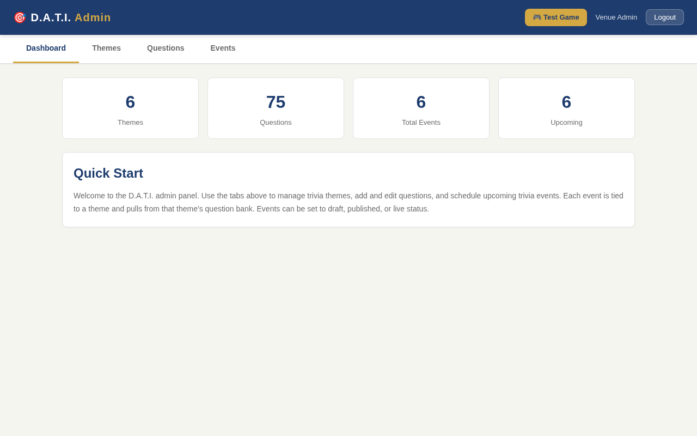
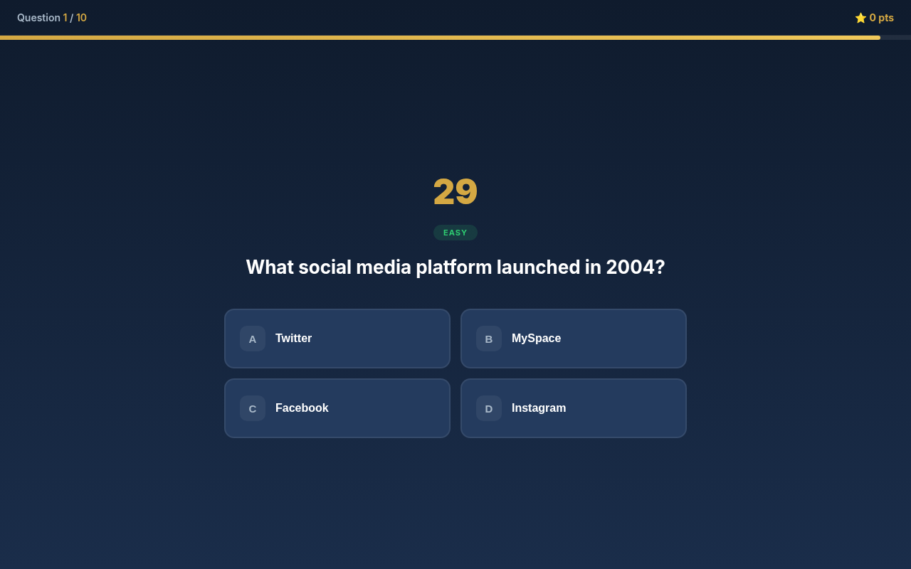
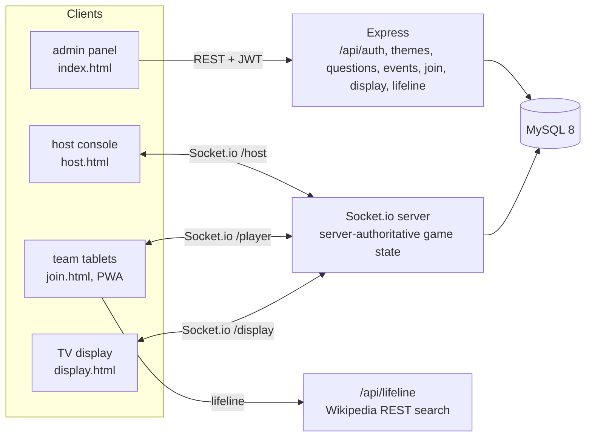

# D.A.T.I. [Don’t Ask the Internet]

[](https://github.com/elijahsylar/dati/actions/workflows/ci.yml)

A real-time multiplayer trivia platform for hosted bar trivia nights. Teams join from tablets by scanning a QR code, a host runs the game from a console, a TV display shows questions and the live leaderboard, and every team gets one "Ask the Internet" lifeline: a single 30-second search, announced to the whole room. It was built as a course project at the University of Colorado Denver, around a scenario of a neighborhood bar that wants to fill quiet weeknights.

| Admin panel | Gameplay |
|---|---|
|  |  |

Screenshots show the seeded demo content.

## Architecture



- **Admin (REST)**: themes, a question bank with easy, medium and hard tiers, and events with a draft, published, active, completed lifecycle. Writes need a JWT, and the `role` in it is enforced: an `admin` manages themes, questions and events, a `host` can only run a game (the host console, its team and score lists, and the join QR code and cards), and the admin panel sends a host account to the host page. Passwords are bcrypt-hashed.
- **Game (Socket.io)**: three namespaces. The host console starts each question; the server owns the clock and broadcasts state; team answers are scored on the server and the leaderboard is recomputed from the database after every question.
- **Snapshot recovery**: every client can rebuild its view from a REST snapshot of the current event state, so a tablet that drops Wi-Fi, or a host or display that joins late, recovers without the game restarting.
- **Join flow**: each published event gets a 6-character join code from a 31-character alphabet with no look-alike characters (no I, L, O, 0 or 1), shown as `ABC-234`, with a QR code and a printable 2x2 tent-card sheet for the tables.
- **Lifeline**: the in-app search calls Wikipedia's REST API server-side and renders results as escaped HTML from the app's own origin, so the tablet never leaves the app. Only Wikipedia's search-match highlights are allowed through as markup.

## Stack

Node.js, Express, Socket.io, MySQL 8 (mysql2), JWT, bcrypt, `express-rate-limit`, `qrcode`; vanilla HTML, CSS and JavaScript on the client, installable as a PWA. Tests use `node:test`.

## Technically notable parts

**Scoring.** Correct answers earn 10 points within 10 seconds, 7 within 20, and 5 after that, multiplied by difficulty (easy 1x, medium 1.5x, hard 2x). Wrong or untimed answers earn 0. Tablets report their response time, and the server rejects any report longer than the time since it started the question (with 1 second of slack).

**Server-authoritative timing.** The question timer runs on the server. Clients render the remaining seconds from the server's start time, and late joiners get the remaining time from the snapshot, so every device counts down to the same deadline.

**Data model.** Base schema plus four forward migrations with matching `.down.sql` files (teams, team answers, event state, join codes) and a JavaScript backfill that issues join codes to events published before codes existed.

**CORS and login limits.** The origins listed in `CORS_ORIGIN` (comma-separated, exact, no wildcard; by default only `http://localhost:<PORT>`) are the only ones that receive CORS headers, for the REST API and for the Socket.io HTTP handshake. Requests from any other origin are still answered, but a browser will not let that page read the response. WebSocket connections are not origin-checked: `/display` and `/player` are public by design, and `/host` needs a token. The app's own pages are same-origin and need no entry. Failed logins are limited to 5 per username from one client address and 20 per client address across all usernames in 15 minutes, after which `POST /api/auth/login` answers 429; successful logins are not counted. A login username may only contain the letters A to Z in either case, digits, `_`, `.` and `-`, and be at most 50 characters; anything else, and any username or password that is not a non-empty string, is refused with 400 before it is counted or queried. Upper and lower case spellings of a username share one counter. Because the username limit is per client address, one address cannot lock an account for everyone else; guesses spread over many addresses are each limited separately. The client address is the connecting address, except behind a reverse proxy on the same machine: Express is set to trust `X-Forwarded-For` from loopback only (`trust proxy` is `loopback`), so each real client is counted separately there and a direct client cannot fake its address with that header. A proxy on another machine is not trusted and would need that setting changed. The counters are in memory, per process.

**First-run setup.** `POST /api/auth/setup` only replaces the seeded placeholder password hash, so it can set the first admin password but can never reset an existing one. It needs a setup secret from the environment (`SETUP_SECRET`, at least 16 characters, sent in the `X-Setup-Secret` header and compared in constant time). With no secret configured, with one shorter than 16 characters, or once no placeholder account is left, the route answers 404.

## Running locally

Requirements: Node.js 18 or newer and MySQL 8.

```bash
git clone https://github.com/elijahsylar/dati.git
cd dati
npm install
```

Create the database and load the schema, migrations and demo content:

```bash
mysql -u root -p < db/schema.sql
for m in 001_teams 002_team_answers 003_event_state 004_event_join_codes; do
  mysql -u root -p < db/migrations/$m.sql
done
mysql -u root -p < db/seed.sql
```

Configure and start:

```bash
cp .env.example .env      # fill in DB_*, JWT_SECRET and SETUP_SECRET (see below)
node db/migrations/005_backfill_join_codes.js
npm start                 # http://localhost:3000
```

`JWT_SECRET` signs the login tokens and must be a random value of at least 32 characters; generate one with `openssl rand -hex 32`. The server refuses to start, with one line saying why, while it is unset, shorter than that, or still the placeholder from `.env.example`.

Set the first password of each seeded account (`admin` and `host1`; works once per account). The request must carry the `SETUP_SECRET` from `.env`. It must be at least 16 characters; generate one with `openssl rand -hex 32`. `.env.example` ships it empty, and while it is empty or shorter than 16 characters the route is switched off (404):

```bash
curl -X POST http://localhost:3000/api/auth/setup \
  -H "Content-Type: application/json" \
  -H "X-Setup-Secret: <the SETUP_SECRET from .env>" \
  -d '{"username":"admin","password":"<choose one>"}'
```

When the passwords are set, remove `SETUP_SECRET` from `.env` and restart. The route also answers 404 by itself once no seeded placeholder password is left.

| Page | Path |
|---|---|
| Admin panel | `/` |
| Single-device gameplay demo | `/play.html` |
| Host console | `/host.html` |
| Team join | `/join.html` |
| TV display | `/display.html` |

`VENUE_NAME` sets the footer on the printed join cards, and `LIFELINE_CONTACT` the contact in the lifeline's User-Agent, and `CORS_ORIGIN` lists the other origins allowed to call the API (not needed when the pages are served by this server).

### Tests

```bash
npm test
```

76 tests. The pure functions: the scoring table and its boundaries, join-code alphabet and formatting, HTML escaping, the lifeline excerpt sanitizer and article links. The first-run setup guard and its setup secret, against a stubbed database pool. Role enforcement on every REST route (`test/roles.test.js`). The admin panel's handling of a host account (`test/admin-panel.test.js`, the real `admin.js` run in a node `vm` against a stand-in DOM, not a browser). The CORS origin list on REST and Socket.io (`test/cors.test.js`) and the login limits (`test/login-limit.test.js`), and the loopback-only proxy trust they count addresses by (`test/trust-proxy.test.js`). The Socket.io game flow (`test/socket.test.js`), with real Socket.io clients against the server on a local port and an in-memory fake of the database pool (`test/fake-db.js`): host authentication and roles, joining as a team and reconnecting with a session token, answers, scoring and the timing check, the early lock and the server timer, the end of the game, and snapshot recovery over both the socket and REST. The start-up check on `JWT_SECRET` (`test/startup-config.test.js`, which also starts the real server as a child process and stops it). No MySQL is needed; the SQL itself is not exercised.

## Project status

A completed course prototype; it is not running anywhere. Planned but not built: analytics for returning teams, and kiosk-mode setup guides for the tablets.

## Project history

The private original has commits from 24 February 2026 to 4 November 2026. Most of it was written between February and May 2026; the November 2026 commits are fixes. This public repository is a scrubbed snapshot of that private original, published in November 2026, which is why its commit history is short. Developed with Claude Code under a gated workflow of written plan, implementation, separate review and my sign-off.

## License

MIT. See [LICENSE](LICENSE). The demo trivia questions in `db/seed.sql` were written for this project.
