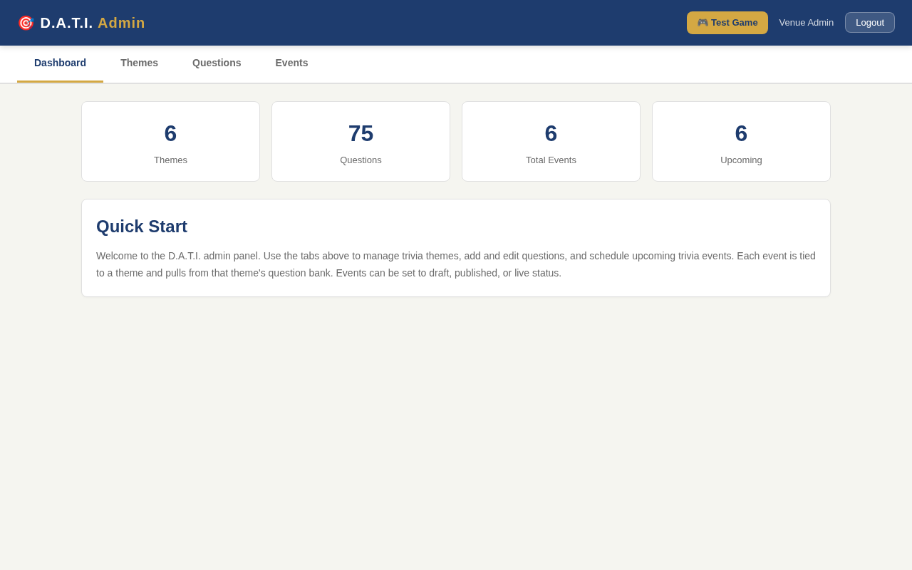
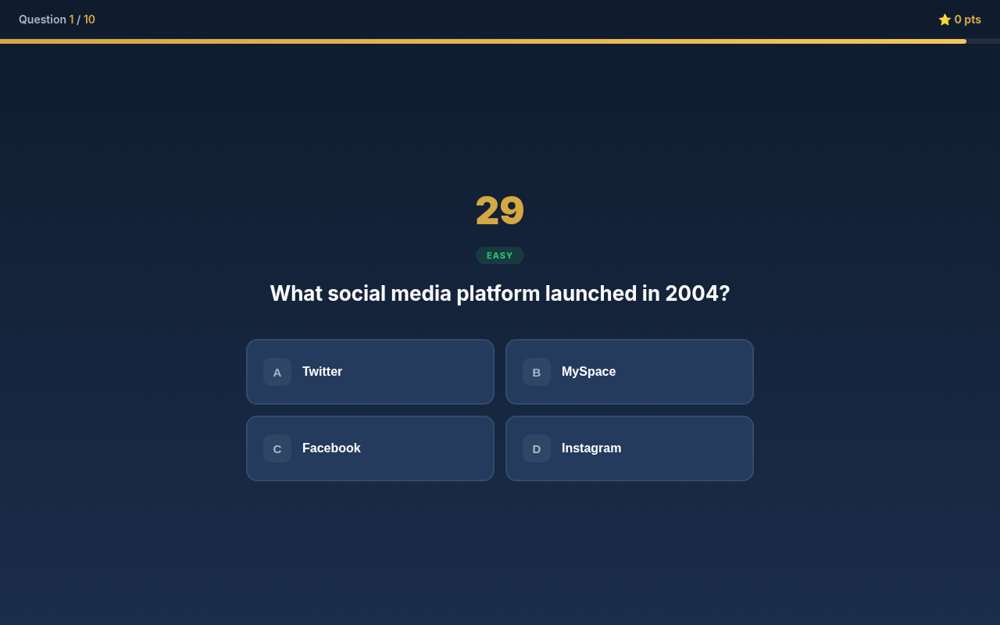
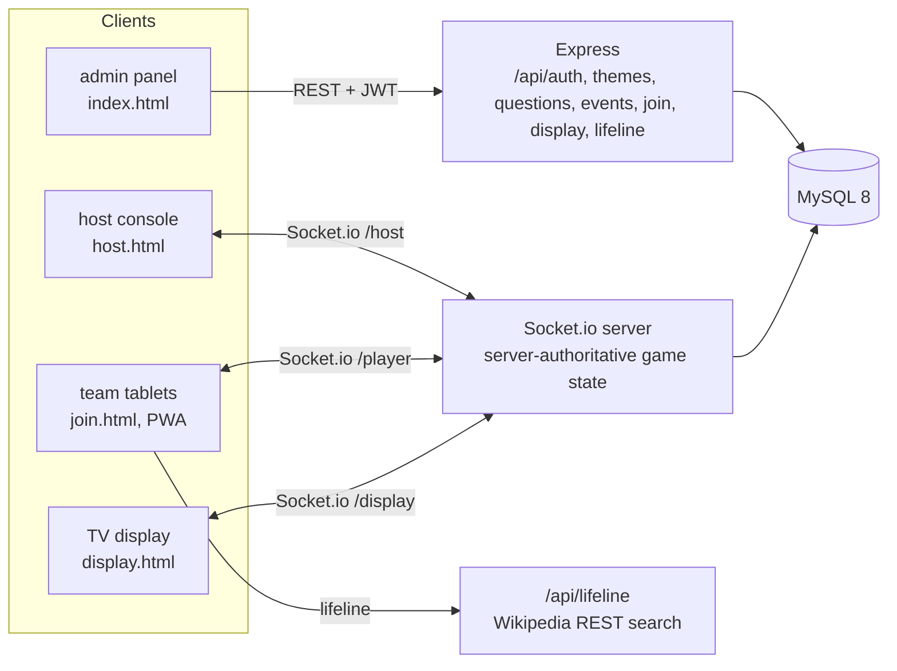

# D.A.T.I. [Don’t Ask the Internet]

[](https://github.com/elijahsylar/dati/actions/workflows/ci.yml)

A real-time multiplayer trivia platform for hosted bar trivia nights. Teams join from tablets by scanning a QR code, a host runs the game from a console, a TV display shows questions and the live leaderboard, and every team gets one "Ask the Internet" lifeline: a single 30-second search, announced to the whole room. It was built as a course project at the University of Colorado Denver, around a scenario of a neighborhood bar that wants to fill quiet weeknights.

| Admin panel | Gameplay |
|---|---|
|  |  |

Screenshots show the seeded demo content.

## Architecture



- **Admin (REST)**: themes, a question bank with easy, medium and hard tiers, and events with a draft, published, active, completed lifecycle. Writes need a JWT; admin passwords are bcrypt-hashed.
- **Game (Socket.io)**: three namespaces. The host console starts each question; the server owns the clock and broadcasts state; team answers are scored on the server and the leaderboard is recomputed from the database after every question.
- **Snapshot recovery**: every client can rebuild its view from a REST snapshot of the current event state, so a tablet that drops Wi-Fi, or a host or display that joins late, recovers without the game restarting.
- **Join flow**: each published event gets a 6-character join code from a 31-character alphabet with no look-alike characters (no I, L, O, 0 or 1), shown as `ABC-234`, with a QR code and a printable 2x2 tent-card sheet for the tables.
- **Lifeline**: the in-app search calls Wikipedia's REST API server-side and renders results as escaped HTML from the app's own origin, so the tablet never leaves the app. Only Wikipedia's search-match highlights are allowed through as markup.

## Stack

Node.js, Express, Socket.io, MySQL 8 (mysql2), JWT, bcrypt, `qrcode`; vanilla HTML, CSS and JavaScript on the client, installable as a PWA. Tests use `node:test`.

## Technically notable parts

**Scoring.** Correct answers earn 10 points within 10 seconds, 7 within 20, and 5 after that, multiplied by difficulty (easy 1x, medium 1.5x, hard 2x). Wrong or untimed answers earn 0. Tablets report their response time, and the server rejects any report longer than the time since it started the question (with 1 second of slack).

**Server-authoritative timing.** The question timer runs on the server. Clients render the remaining seconds from the server's start time, and late joiners get the remaining time from the snapshot, so every device counts down to the same deadline.

**Data model.** Base schema plus four forward migrations with matching `.down.sql` files (teams, team answers, event state, join codes) and a JavaScript backfill that issues join codes to events published before codes existed.

**First-run setup.** `POST /api/auth/setup` only replaces the seeded placeholder password hash, so it can set the first admin password but can never reset an existing one.

## Running locally

Requirements: Node.js 18 or newer and MySQL 8.

```bash
git clone https://github.com/elijahsylar/dati.git
cd dati
npm install
```

Create the database and load the schema, migrations and demo content:

```bash
mysql -u root -p < db/schema.sql
for m in 001_teams 002_team_answers 003_event_state 004_event_join_codes; do
  mysql -u root -p < db/migrations/$m.sql
done
mysql -u root -p < db/seed.sql
```

Configure and start:

```bash
cp .env.example .env      # fill in DB_* and a long random JWT_SECRET
node db/migrations/005_backfill_join_codes.js
npm start                 # http://localhost:3000
```

Set the first admin password (works once per seeded account):

```bash
curl -X POST http://localhost:3000/api/auth/setup \
  -H "Content-Type: application/json" \
  -d '{"username":"admin","password":"<choose one>"}'
```

| Page | Path |
|---|---|
| Admin panel | `/` |
| Single-device gameplay demo | `/play.html` |
| Host console | `/host.html` |
| Team join | `/join.html` |
| TV display | `/display.html` |

`VENUE_NAME` sets the footer on the printed join cards, and `LIFELINE_CONTACT` the contact in the lifeline's User-Agent.

### Tests

```bash
npm test
```

10 tests: the scoring table and its boundaries, join-code alphabet and formatting, HTML escaping, the lifeline excerpt sanitizer and article links, and the first-run setup guard (against a stubbed database pool, so no MySQL is needed). They do not cover the Socket.io game flow.

## Project status

A completed course prototype; it is not running anywhere. Planned but not built: analytics for returning teams, and kiosk-mode setup guides for the tablets.

## License

MIT. See [LICENSE](LICENSE). The demo trivia questions in `db/seed.sql` were written for this project.
